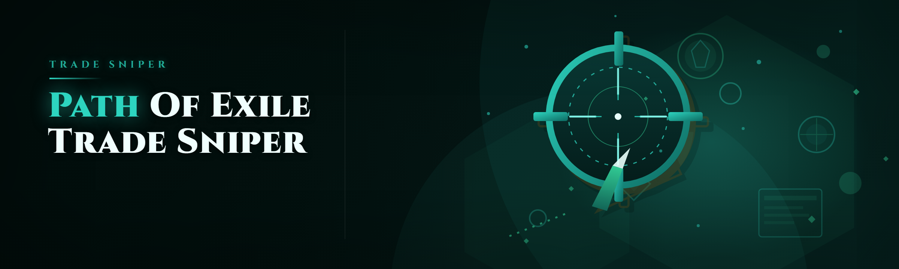

  
  
  

  

  
  
  

---

Path of Exile trade sniper: live trade API polling, instant whisper alerts, custom loot filters, price-flip sniping for cheap listings

## Overview

Path of Exile trade sniper: live trade API polling, instant whisper alerts, custom loot filters, price-flip sniping for cheap listings

  

## License

[MIT License](LICENSE)

  

